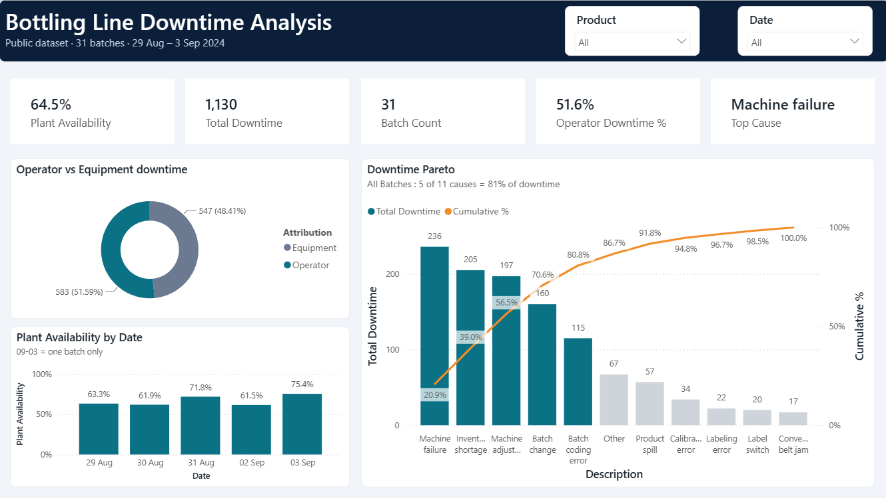
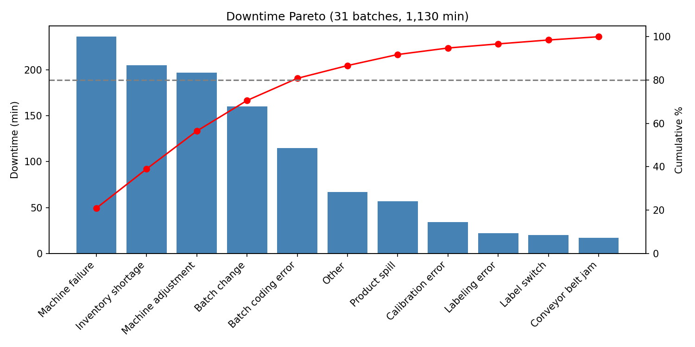
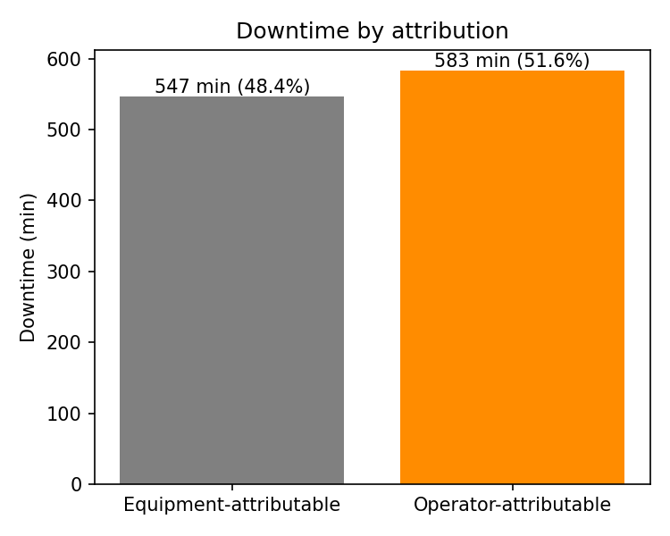
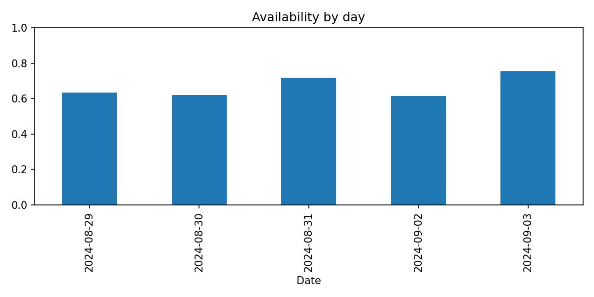
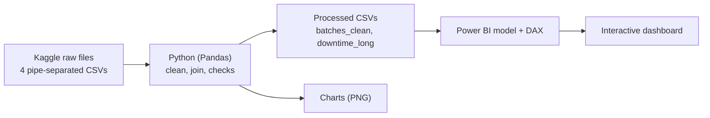

# Bottling Line Downtime Analysis


[](https://colab.research.google.com/github/harshpaswanpro/bottling-downtime-analysis/blob/main/bottling_downtime_analysis.ipynb)

Where does a soda-bottling line lose time, how much of that loss is operator-attributable, and how does availability vary by day and product? This project answers those questions with **Python (Pandas)** for cleaning and analysis and an interactive **Power BI** dashboard (DAX) for exploration.



## Key findings

| Metric | Result |
|---|---|
| Batches analysed | 31 (5 products, 5 production days: 29 Aug to 3 Sep 2024) |
| Total downtime | 1,130 min |
| Plant availability | 64.5% (ideal batch time / actual batch time) |
| Largest cause | Machine failure: 236 min (20.9%) |
| Vital few | 5 of 11 causes account for 80.8% of downtime |
| Operator vs equipment | 583 min operator-attributable (51.6%) vs 547 min equipment (48.4%) |

**Downtime Pareto (minutes):** Machine failure 236, Inventory shortage 205, Machine adjustment 197, Batch change 160, Batch coding error 115, Other 67, Product spill 57, Calibration error 34, Labeling error 22, Label switch 20, Conveyor belt jam 17.

**Reading the results**
- Losses are spread over several causes rather than one dominant cause, so the Pareto is mild (5 of 11 causes to reach 80%), not a classic 80/20.
- Operator-flagged causes (batch change, machine adjustment, batch coding error, product spill, calibration error, label switch) make up about half of all downtime. In an operating plant these would point to training and changeover standardisation, while the rest points to maintenance and supply planning.
- Daily availability ranged from 61.5% to 75.4%. The last day contains a single batch, so it is not evidence of a trend.

## Analysis charts

Generated by the notebook and script (`images/`).



| Operator vs equipment | Availability by day |
|---|---|
|  |  |

## Data caveats (please read)

- **This is availability, not full OEE.** In all 31 batches, actual run time (batch time minus logged downtime) equals the product's minimum batch time, so Performance is always 100%. The dataset has no units produced or scrap, so Quality cannot be computed. OEE therefore reduces to Availability here.
- **Small sample:** 31 batches over five days. Product-level figures are not reliable (OR-600 has one batch). This project demonstrates a method; it does not support claims about improvement.
- **Public practice dataset**, not data from a real plant.
- 7 batches (422137 to 422143) have downtime records but no production record (no start or end time), so they are excluded.
- The source files are pipe-separated, `line-downtime.csv` has a second header row, and some end times carry a stray `1900-01-01` date. The code handles all three, and also batches that cross midnight.

## Pipeline



## Method

1. Load the four tables and clean them (see caveats).
2. Batch duration = end time minus start time. Downtime per batch = sum of the 12 factor columns.
3. Availability = minimum batch time / actual batch time, aggregated time-weighted (not an average of ratios).
4. Pareto on downtime minutes by cause, plus an operator vs equipment split from the dataset's "Operator Error" flag.
5. Sanity check: downtime totals from the long-format table and the per-batch table both equal 1,130 min.
6. Export two clean tables for the Power BI model (`batches_clean` and `downtime_long`, related on `Batch`).

## Power BI measures (DAX)

```DAX
Plant Availability =
DIVIDE ( SUM ( batches_clean[Min batch time] ), SUM ( batches_clean[BatchMinutes] ) )

Total Downtime = SUM ( downtime_long[DowntimeMinutes] )

Operator Downtime % =
DIVIDE (
    CALCULATE ( [Total Downtime], downtime_long[Operator Error] = "Yes" ),
    [Total Downtime]
)

Batch Count = COUNTROWS ( batches_clean )

Cumulative % =
VAR CurrentDT = [Total Downtime]
VAR Cum =
    CALCULATE (
        [Total Downtime],
        FILTER ( ALLSELECTED ( downtime_long[Description] ), [Total Downtime] >= CurrentDT )
    )
RETURN
    DIVIDE ( Cum, CALCULATE ( [Total Downtime], ALLSELECTED ( downtime_long[Description] ) ) )

Top Cause =
MAXX (
    TOPN ( 1, VALUES ( downtime_long[Description] ), [Total Downtime], DESC ),
    downtime_long[Description]
)
```

## Repository structure

```
.
├── README.md
├── requirements.txt
├── bottling_downtime_analysis.ipynb   # step-by-step walkthrough with outputs
├── downtime_analysis.py               # same logic as a single script
├── bottling_downtime_dashboard.pbix   # Power BI dashboard
├── data/
│   ├── raw/                           # 4 source files + metadata.csv (CC0)
│   └── processed/                     # batches_clean.csv, downtime_long.csv
└── images/                            # dashboard.png, pareto.png, operator_split.png, daily_availability.png
```

## How to reproduce

**Option A: notebook (Google Colab).** Click the Colab badge, upload `line-productivity.csv`, `line-downtime.csv`, `downtime-factors.csv` and `products.csv` (from `data/raw/`) to the session storage (the notebook reads them from the working directory), then choose Runtime > Run all.

**Option B: script (local).**

```
git clone https://github.com/harshpaswanpro/bottling-downtime-analysis.git
cd bottling-downtime-analysis
pip install -r requirements.txt
python downtime_analysis.py
```

Both options write `batches_clean.csv`, `downtime_long.csv` and the chart images. To explore the dashboard, open the `.pbix` in Power BI Desktop, or load the two processed CSVs and recreate the relationship and measures above.

## Limitations and next steps
- With units produced and scrap data, compute true OEE (Availability x Performance x Quality).
- With more weeks of data, test whether the Pareto ranking is stable and add control charts for daily availability.
- With cause-level cost data, rank causes by money lost instead of minutes.

## Data source
Kaggle, *Predict Manufacturing Downtime Performance dataset* (Agung Pambudi), released under CC0 (public domain). The raw files are included in `data/raw/` for convenience, together with `metadata.csv`, a data dictionary the code does not need. Original dataset: https://www.kaggle.com/datasets/agungpambudi/predict-manufacturing-downtime-performance-dataset

## Author
Harsh Paswan, B.Tech Chemical Engineering, BIT Mesra. GitHub: [@harshpaswanpro](https://github.com/harshpaswanpro)
